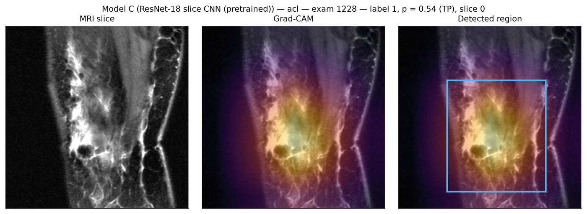

# Convolutional Neural Networks for Knee MRI


Experimental pipeline for the UTS Honours thesis **_Investigating the Efficacy of CNNs in
Improving Diagnosis and Injury Detection Accuracy for Ligament and Meniscal Damage_**. This
project README documents the **MRNet v1.0** dataset workflow.

> **Author:** John Sciuto (24814764) <br>
> **Supervisor:** Wei Wei <br>

---

## Contents

- [Overview](#overview)
- [Models](#models)
- [Quick start](#quick-start)
- [MRNet data](#mrnet-data)
- [Outputs](#outputs)
- [Repository structure](#repository-structure)
- [Reproducibility](#reproducibility)
- [Licence](#licence)
- [Acknowledgements](#acknowledgements)

## Overview

The pipeline trains and evaluates convolutional neural networks on MRNet knee MRI exams. It
uses the dataset's training split for model development and tuning, and its public validation
split for final evaluation. The prediction tasks are abnormality, ACL tear, and meniscal tear
detection.

Training runs save per-exam probabilities to CSV. Evaluation tables and figures can therefore
be regenerated from `outputs/` without retraining (thesis §3.11).



*Example output: Grad-CAM saliency from model C (ResNet-18) for the ACL task on a test exam.
The right panel boxes the most activated region.*

## Models

| Config | Model | Type |
|:---:|---|---|
| **A** | Fully connected network | Baseline |
| **B** | AlexNet | 2D slice CNN |
| **C** | ResNet-18 | 2D slice CNN |
| **D** | MONAI DenseNet-121 | 3D volumetric CNN |
| **E** | MONAI-pipeline ablation | Ablation study |

The architectures are detailed in thesis Table 3.3 and implemented in `src/models.py`.

## Quick start

### 1. Set up the environment

```bash
python3.11 -m venv .venv
.venv/bin/pip install -r requirements.txt
.venv/bin/python -m ipykernel install --user --name thesis-cnn --display-name "Python (thesis-cnn)"
```

### 2. Prepare MRNet and run notebooks

Download MRNet v1.0 from [Stanford AIMI](https://stanfordmlgroup.github.io/competitions/mrnet/)
and extract it into `data/MRNet-v1.0/` (see [MRNet data](#mrnet-data)). In VS Code, select the
**Python (thesis-cnn)** kernel and run the notebooks in order:

| Notebook | What it does |
|---|---|
| `notebooks/01_data_setup.ipynb` | Environment checks, MRNet paths, splits and dataset figures |
| `notebooks/02_training.ipynb` | Sanity checks, timing and model training |
| `notebooks/03_evaluation_and_figures.ipynb` | Thesis tables, statistics, figures and Grad-CAM |

## MRNet data

MRNet v1.0 is provided by the [Stanford ML Group / AIMI](https://stanfordmlgroup.github.io/competitions/mrnet/).
Obtain the dataset from its official source and follow its terms of use. The data is not included
in this repository and the `data/` directory is git-ignored.

Place the extracted dataset in this layout:

```
data/
└── MRNet-v1.0/
    ├── train/
    │   ├── axial/*.npy
    │   ├── coronal/*.npy
    │   └── sagittal/*.npy
    ├── valid/
    │   ├── axial/*.npy
    │   ├── coronal/*.npy
    │   └── sagittal/*.npy
    ├── train-{abnormal,acl,meniscus}.csv
    └── valid-{abnormal,acl,meniscus}.csv
```

Each exam is represented as a stack of NumPy slices for each of the three imaging planes:
axial, coronal, and sagittal. The CSV files provide exam-level labels for abnormality, ACL tear,
and meniscal tear. For large archives, `7z x MRNet-v1.0.zip` can be used to extract the files

## Outputs

Running the three notebooks produces:

- `splits/`: the development and tuning exam IDs, committed so experiments rerun on the same
  partitions
- `outputs/runs/<model>_<plane>_s<seed>/`: one folder per training run, holding the best
  checkpoint (`best.pt`, git-ignored due to size), per-exam prediction CSVs for the tuning and
  test sets, and a `log.json` with the hyperparameters and per-epoch history
- `outputs/tables/`: Table 3.2 (data partitions) plus Tables 4.1, 4.2, 4.3 and 4.5 as CSVs
- `outputs/figures/`: ROC curves, calibration diagrams, training curves, confusion matrices,
  dataset montages and the slice-count histogram, all at 300 dpi
- `outputs/figures/gradcam/`: Grad-CAM panels for models C and D (true positives and false
  negatives per task) and a three-plane comparison figure

The prediction CSVs and logs are committed, so every table and figure can be rebuilt without
retraining. `docs/THESIS_FIGURE_GUIDE.md` maps each artifact to its thesis section.

## Repository structure

```
notebooks/          the three run-in-order notebooks
src/                importable pipeline code
├── config.py       paths, tasks, model registry, hyperparameters and budget settings
├── data.py         MRNet labels, splits, transforms, exam dataset and smoke data
├── models.py       the five architectures (thesis Table 3.3)
├── training.py     training loop, early stopping and timing/search utilities
├── metrics.py      DeLong CI and paired tests, Youden, Brier, ECE and BH correction
├── fusion.py       logistic-regression multi-plane fusion
├── evaluate.py     builds thesis evaluation tables from saved predictions
├── gradcam.py      Grad-CAM saliency and detection-box figures
└── plots.py        ROC, calibration, training-curve and dataset figures (300 dpi)
splits/             saved split assignments for reproducibility
outputs/            runs (checkpoints and predictions), tables and figures
docs/               assets for README
```

## Reproducibility

- Split assignments can be found under `splits/` so experiments can be rerun on
  identical partitions
- Each run writes checkpoints and per-exam prediction CSVs to `outputs/runs/`; evaluation
  tables and figures can be rebuilt from those saved predictions
- Dependencies are written in `requirements.txt`

## Licence

Copyright © 2026 John Sciuto. This github repo contains code written for an Honours thesis
and is provided for academic and examination purposes

See [LICENSE](./LICENSE).

## Acknowledgements

- **Wei Wei** — thesis supervisor, University of Technology Sydney
- The **Stanford ML Group / AIMI** for the MRNet dataset
- Built w/ [PyTorch](https://pytorch.org/) and [MONAI](https://monai.io/)
